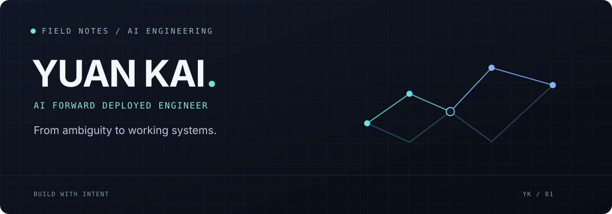

  

 

**AI FORWARD DEPLOYED ENGINEERING** &nbsp; / &nbsp; **BUILD · SHIP · LEARN**

Turning open-ended problems into useful AI systems.

 

### `01` &nbsp; The work

I work at the intersection of **AI, engineering, and real-world problems**. I like getting close to the problem, making ideas tangible, and iterating until the system is useful.

<table>
  <tr>
    <td width="33%" valign="top"><b>01 / Understand</b>  Start with the people, the workflow, and the actual problem.</td>
    <td width="33%" valign="top"><b>02 / Build</b>  Turn ambiguity into a working prototype and a practical system.</td>
    <td width="33%" valign="top"><b>03 / Improve</b>  Learn from real use, measure what matters, and keep iterating.</td>
  </tr>
</table>

### `02` &nbsp; Exploring

`AI agents` &nbsp; `LLM applications` &nbsp; `human-in-the-loop` &nbsp; `evaluation` &nbsp; `applied AI`

 

  Curious about what's possible. Focused on what works.

